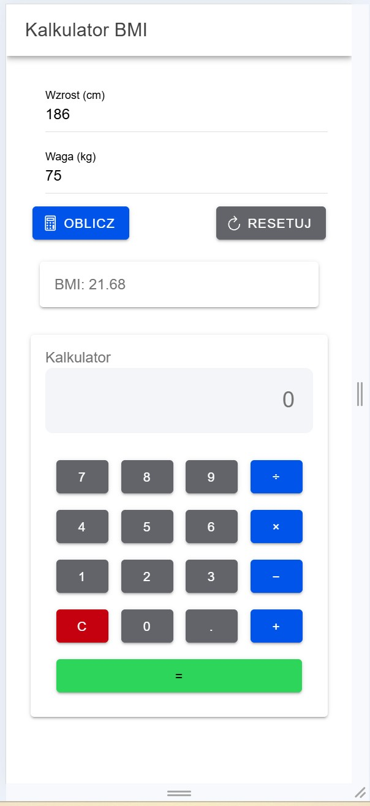
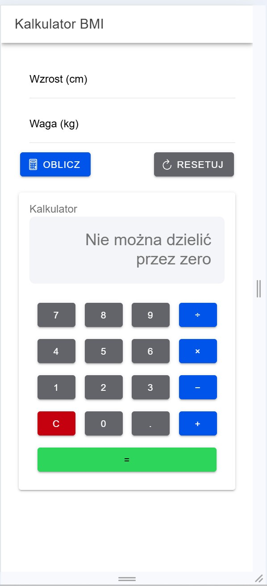

# Lab 04 – Aplikacja Ionic React

## Uruchomienie aplikacji

1. Zainstaluj Node.js.
2. Otwórz terminal w folderze lab_04.
3. Zainstaluj zależności:

   npm install

4. Uruchom aplikację:

   ionic serve

5. Otwórz przeglądarkę pod adresem:

   http://localhost:8100

## Zrzuty ekranu

### 1. Kalkulator BMI

### 2. Kalkulator – zadanie 3
