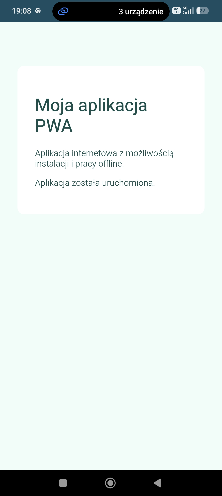

# Lab 01 – Progressive Web App (PWA)

## Co zostało zrealizowane

W ramach laboratorium przygotowano aplikację typu Progressive Web App (PWA).

Aplikacja zawiera manifest z nazwą, kolorami i ikonami, Service Workera oraz obsługę trybu offline. W przypadku otwarcia niedostępnej podstrony bez połączenia z Internetem wyświetlana jest własna strona `offline.html`.

Dodano przycisk umożliwiający instalację aplikacji w obsługiwanej przeglądarce. Aplikację opublikowano za pomocą Firebase Hosting, dzięki czemu jest dostępna przez HTTPS.

## Uruchomienie

1. Otwórz opublikowaną aplikację w przeglądarce Chrome.
2. Skorzystaj z przycisku instalacji, aby dodać aplikację do urządzenia.
3. Aby przetestować działanie offline, otwórz narzędzia deweloperskie Chrome i włącz tryb Offline.

**Adres opublikowanej aplikacji:**  
Hosting URL: https://pwa-lab01-6acaa.web.app

## Zrzut ekranu zainstalowanej aplikacji na telefonie

