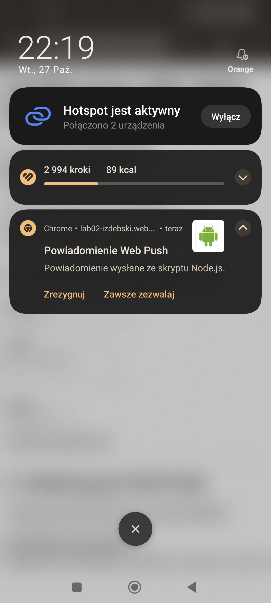

# Lab 02 – Powiadomienia i Web Push

## Co zostało zrealizowane

W ramach laboratorium rozbudowano aplikację PWA o obsługę powiadomień.

Zaimplementowano następujące funkcjonalności:

- Pytanie o zgodę na powiadomienia dopiero po kliknięciu przycisku przez użytkownika.
- Obsługę powiadomień za pomocą Notification API.
- Wyświetlanie powiadomień za pomocą Service Workera.
- Rejestrację Service Workera i obsługę zdarzeń powiadomień.
- Obsługę kliknięcia powiadomienia.
- Przygotowanie obsługi Web Push z wykorzystaniem kluczy VAPID i biblioteki `web-push`.
- Testowanie działania aplikacji lokalnie.

## Uruchomienie

Wymagania:
- Node.js i npm.
- Przeglądarka obsługująca Service Workera i powiadomienia.
- Zgoda użytkownika na wyświetlanie powiadomień.

Aby uruchomić aplikację lokalnie:

1. Otwórz terminal w katalogu projektu `lab_02`.
2. Zainstaluj zależności poleceniem:

   `npm install`

3. Uruchom serwer lokalny poleceniem:

   `npx serve public`

4. Otwórz adres wyświetlony w terminalu.
5. Kliknij przycisk w aplikacji, aby wyrazić zgodę na powiadomienia i przetestować ich działanie.

Do testowania Web Push mogą być wymagane dodatkowe kroki konfiguracyjne opisane w kodzie projektu.

**Adres opublikowanej aplikacji:**
Hosting URL: https://lab02-izdebski.web.app

