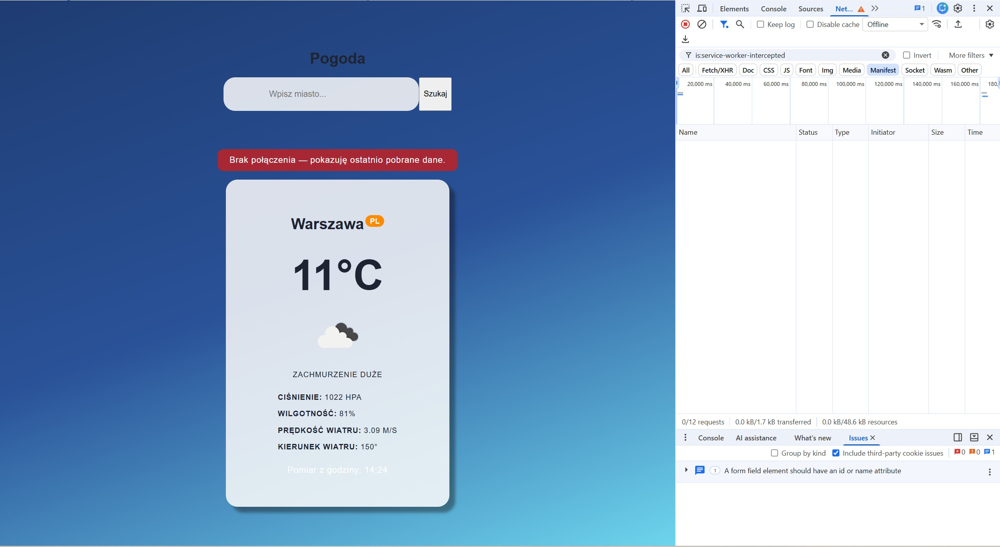
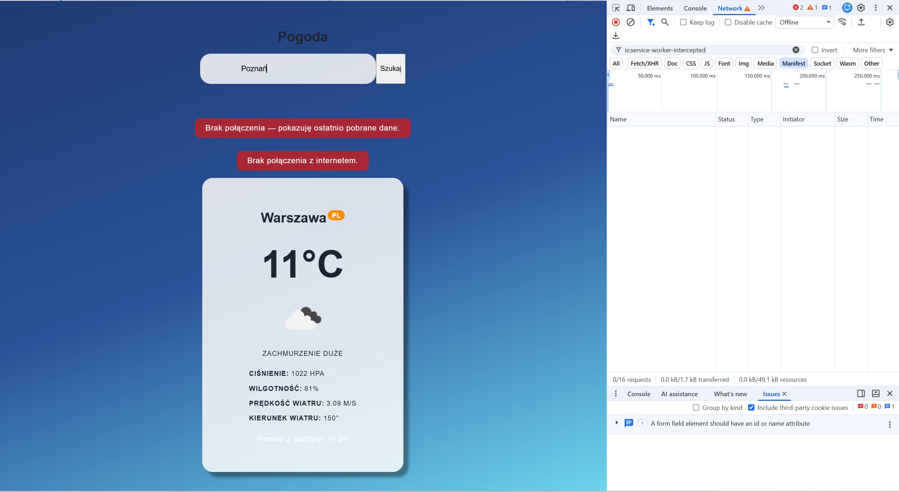
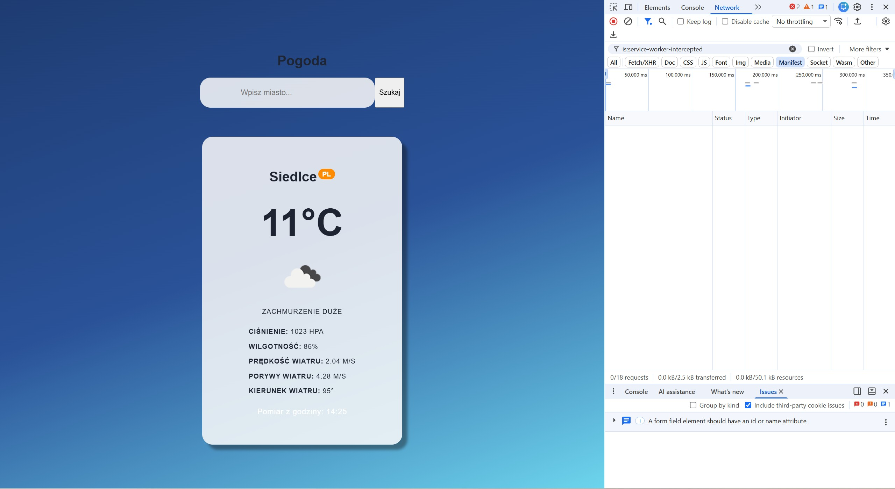

# Laboratorium 3 — Weather App PWA

## Opis projektu

Aplikacja pogodowa napisana w React z wykorzystaniem Vite oraz API OpenWeatherMap. Umożliwia wyszukiwanie pogody dla wybranego miasta, wyświetlanie parametrów atmosferycznych oraz korzystanie z ostatnio pobranych danych bez połączenia z internetem.

## Technologie

- React
- Vite
- JavaScript
- OpenWeatherMap Current Weather API
- vite-plugin-pwa
- Workbox
- Service Worker

## Uruchomienie

Instalacja zależności:

```bash
npm install
```

Tryb deweloperski:

```bash
npm run dev
```

Budowanie wersji produkcyjnej:

```bash
npm run build
```

Podgląd wersji produkcyjnej:

```bash
npm run preview
```

## Funkcjonalności

1. Wyszukiwanie pogody dla miasta.
2. Wyświetlanie temperatury, ikony i opisu pogody.
3. Wyświetlanie ciśnienia, wilgotności i parametrów wiatru.
4. Wyświetlanie godziny pomiaru.
5. Obsługa błędów API i braku połączenia.
6. Buforowanie odpowiedzi pogodowych za pomocą strategii NetworkFirst.
7. Buforowanie ikon pogodowych za pomocą strategii CacheFirst.
8. Instalacja aplikacji jako PWA.

## Dokumentacja testów


## Zrzut ekranu zainstalowanej aplikacji na telefonie



